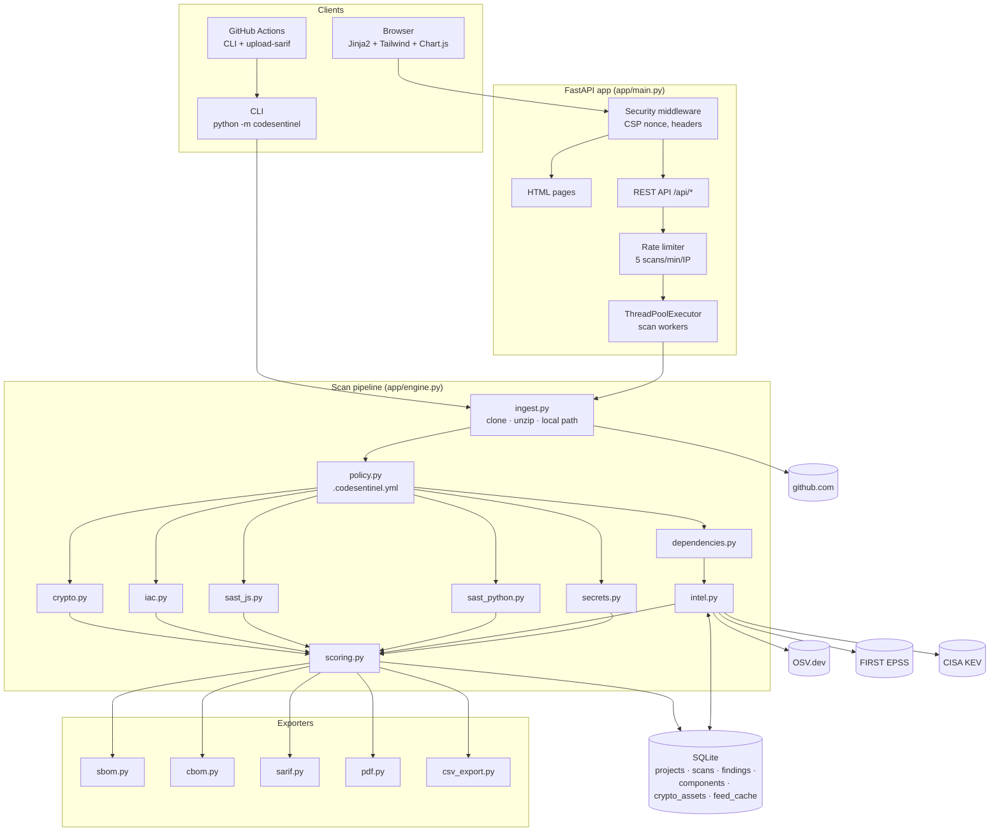
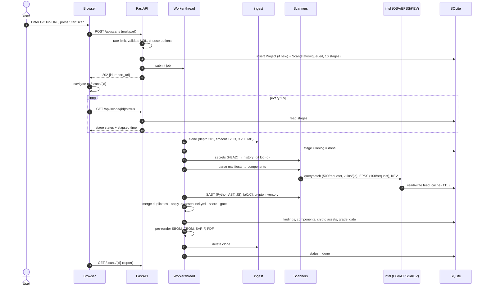
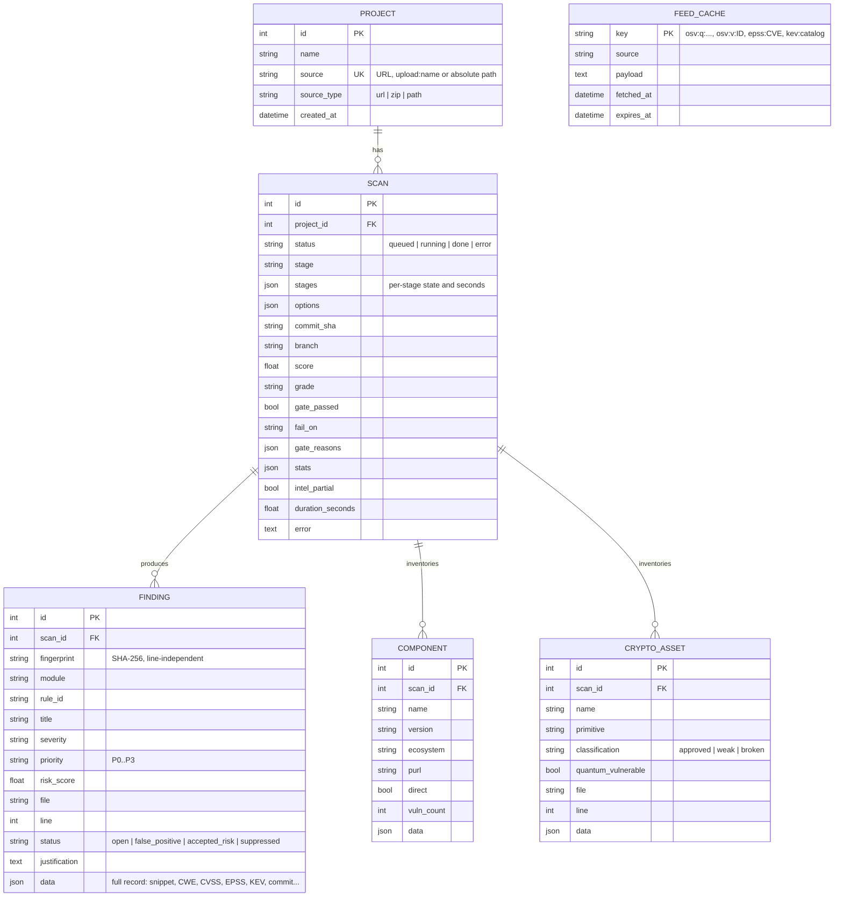

# CodeSentinel architecture

This document describes how CodeSentinel is put together, how a scan flows through it, how data is stored, and why the main design decisions were made.

## 1. Components

| Layer | Responsibility |
|---|---|
| `ingest.py` | Turns a target into a directory on disk. GitHub URLs are validated against `https://github.com/owner/repo`, pre-checked for size through the GitHub API, cloned with `git clone --depth N` under a 120 s timeout and a 200 MB cap, and deleted afterwards. Zips are extracted with path-traversal, symlink, entry-count and expansion-size checks. |
| `scanners/` | Five independent analysers that read files and return `Finding` / `Component` / `CryptoAsset` records. None of them executes target code. |
| `intel.py` | Async HTTP client for OSV, EPSS and KEV with a database-backed TTL cache, retries and per-feed degradation. |
| `engine.py` | Orders the stages, reports progress, merges cross-module duplicates, applies policy, scores, and builds the `ScanReport` that every exporter consumes. |
| `scoring.py` | Pure functions: tier, risk, grade, gate. No I/O, so it is easy to test and to explain. |
| `main.py` | Web pages, REST API, background workers, persistence, triage, history diffs. |

## 2. Sequence of a web scan

The CLI runs the same `run_scan()` in-process: no web server, same database cache, exit code from the gate.

## 3. Data model

Columns used for filtering and sorting are real columns; the full scanner record lives in a JSON `data` column, so an export rebuilt from the database is byte-for-byte the same report the scan produced, plus any later triage decisions.

## 4. Design decisions and trade-offs

**One pipeline for CLI, CI and web.** `engine.run_scan()` is the only place stages are ordered. The CLI and the web worker are thin wrappers, so a finding cannot appear in the UI but not in CI.

**Exploit-aware tiers over a single score.** A numeric score alone hides *why* something matters. Tiers encode explicit, auditable rules (KEV → P0) while the risk score orders findings inside a tier and drives the grade. The formula is published in the UI and README so a reviewer can recompute any number.

**AST for Python, tokens for JavaScript.** Python's standard library ships a complete parser, so the Python analyser can track assignments, imports and aliases, and do intra-procedural taint propagation. That is what separates a tainted SQL injection (P0) from a constant query. A JavaScript parser would add a Node toolchain or a heavy dependency; comment-aware token rules catch the common sink patterns with no build step, at the cost of precision on unusual code.

**History scanning with `git log -p`.** Walking diffs with one streamed `git log -p --unified=0` call is far faster than checking out each commit, and only added lines matter for "a secret was introduced". Secrets are de-duplicated by fingerprint: a value present in HEAD is reported once (with the commit that introduced it), and a value present only in history becomes a *historical* finding pinned to its introducing commit. Clones use `--depth 501` so the history cap and the clone depth agree.

**Never hold a secret longer than necessary.** Raw values exist only inside `detect_line()`. Findings store a SHA-256 fingerprint and a redacted preview, and every code snippet, from every module, passes through `redact_text()`. This is enforced by tests that grep reports for planted values.

**Respect `.gitignore` for local scans.** For git work trees the file list is `git ls-files --cached --others --exclude-standard`. A developer's ignored local `.env` is not "in the repository" and should not fail their build; a committed one should, and does.

**Cache feeds in the same database.** OSV advisories change slowly and EPSS updates daily, so caching (12–24 h TTL) makes repeat scans fast (the demo's intel stage drops from about 10 s to under 1 s) and keeps the tool usable when a feed is briefly down. Misses are cached too, so unknown CVEs are not re-queried every scan.

**Graceful degradation over failure.** If EPSS or KEV is unreachable the scan still completes; affected findings carry `intel_partial`, the UI shows a banner, and tiers fall back conservatively (CVSS ≥ 7 with no EPSS is P1, not P2).

**Cross-module de-duplication.** Several modules can see the same line: a hard-coded `SECRET_KEY` is both a SAST rule and a generic secret; `hashlib.md5(password)` is both a SAST rule and a broken-crypto asset. The engine keeps the most specific finding and folds the other's signal into it (for example, the crypto classification still lifts the SAST finding to P1). The crypto asset still appears in the CBOM.

**Server-rendered UI.** Jinja2 with Tailwind (CDN) and Chart.js keeps the stack small: no Node build, no client-side framework. Inline scripts carry a per-request CSP nonce; data reaches charts through `application/json` script blocks, and the client script builds DOM nodes with `textContent` only, so CodeSentinel's own JS rules pass on its own code.

**SQLite.** A single-file database fits a mini-project, a CI runner and a free Render instance. Write-ahead logging and a busy timeout allow the web threads and scan workers to share it. Moving to PostgreSQL only requires `CS_DATABASE_URL`.

**Trade-offs accepted.** No reachability analysis (every advisory on a pinned version is reported); intra-procedural taint only; `package.json` ranges resolve to their minimum version; the in-process rate limiter and thread pool assume one server process. These are listed in the README under Limitations.

## 5. Security of CodeSentinel itself

| Threat | Control |
|---|---|
| Malicious archive (zip-slip, symlinks, zip bomb) | Path normalisation + `is_relative_to` check, symlink entries rejected, entry-count and expanded-size limits, streamed extraction with a running byte budget |
| Huge or slow repository | GitHub API size pre-check, `--depth` clone, 120 s timeout, 200 MB on-disk cap |
| Code execution from the target | No installs, builds or hooks; `git clone` with `protocol.allow=never` except HTTPS; files are only read |
| SSRF through the URL field | Only `https://github.com/owner/repo` is accepted |
| Abuse of the scan endpoint | 5 scans per minute per client IP |
| XSS | Jinja autoescape on; CSP with per-request nonces, no `unsafe-eval`; DOM built with `textContent`; JSON embedded with `tojson` |
| Clickjacking, sniffing, referrer leaks | `frame-ancestors 'none'`, `X-Frame-Options: DENY`, `nosniff`, `Referrer-Policy`, `Permissions-Policy`, HSTS behind HTTPS |
| CSV formula injection in exports | Cells starting with `= + - @` are prefixed with `'` |
| XML entity expansion in `pom.xml` | Documents containing `<!ENTITY` are skipped |
| Secret disclosure through the tool | Fingerprint + redacted preview only; snippets redacted; secrets never validated |
| Local file access from a hosted instance | `CS_ALLOW_LOCAL_PATHS=false` in the Docker image |
